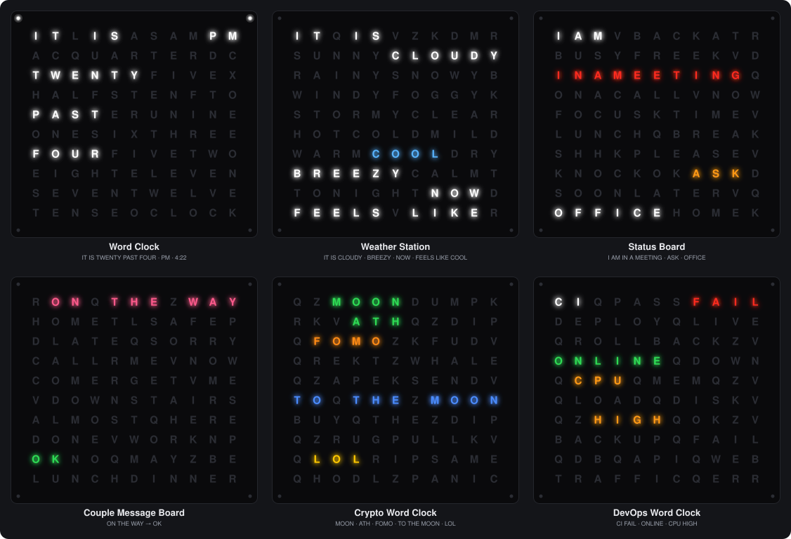

# Word Clock — ESP32-S3 Blueprints No.01

> Part of **[ESP32-S3 Blueprints](#about-esp32-s3-blueprints)**, a Lonely Binary series: finished things you'd actually want on your desk, each shipped with the complete blueprint behind it.

**A word that lights up — instead of a number.**

Most smart displays shout numbers, graphs, and notifications at you. **Lonely Binary Word Clock** whispers a word.

It's an 11×10 letter grid that looks like a plain wall of type until the words you actually need light up: the time, the weather outside, whether you're free or in a meeting, a quiet "HOME SAFE" from someone you love, or a red "DOWN" from a server you're watching at 2am. One piece of hardware, six very different lives. Pick the face that matches yours.

**→ [Install the firmware from your browser](https://lonely-binary.github.io/WordClock/)**

---

## Six panels, one platform

Every panel runs on the same electronics. What changes is the faceplate (which letters are printed where) and the firmware. Flash the firmware that matches your faceplate: a Weather Station faceplate running the Word Clock firmware lights the wrong letters.

| Panel | What lights up | Where the words come from | Folder |
|---|---|---|---|
| 🕑 **Word Clock** | `IT IS TWENTY PAST FOUR` | Internet time, your timezone | [`WordClock/`](WordClock/) |
| 🌤 **Weather Station** | `IT IS CLOUDY … FEELS LIKE COOL` | Open-Meteo (free, no account) | [`WeatherStation/`](WeatherStation/) |
| 💼 **Status Board** | `I AM IN A MEETING … ASK` | You, from your phone or a script | [`StatusBoard/`](StatusBoard/) |
| 💌 **Couple Message Board** | `ON THE WAY` → `OK` | Your partner's panel | [`CoupleBoard/`](CoupleBoard/) |
| 🚀 **Crypto Word Clock** | `MOON` `FOMO` `TO THE MOON` `LOL` | CoinGecko, Fear & Greed index, your friends | [`CryptoClock/`](CryptoClock/) |
| 🖥 **DevOps Word Clock** | `CI FAIL` `DB DOWN` `CPU HIGH` | Your CI, servers and scripts | [`DevOpsClock/`](DevOpsClock/) |

Each folder has its own README with the letter grid, setup and everything the panel can do.

---

## The hardware

- **11×10 WS2812 letter grid**: 110 individually addressable RGB LEDs, one behind each letter
- **4 corner WS2812 LEDs** (114 in total). The Word Clock uses them for the minutes between the five-minute steps; the Weather, Couple, Crypto and DevOps panels light one dimly red when they can't reach their data
- Snaps onto a **standard Lonely Binary ESP32-S3** dev board via an onboard socket, no soldering
- **2 buttons**, wired to `IO42` (button A) and `IO41` (button B), active high
- **USB Type-C power input on the base**, which powers both the ESP32-S3 and the whole LED grid

## ⚠️ Power & flashing — please read

This product has **two Type-C ports**, and they do different jobs:

| Port | Location | Purpose |
|---|---|---|
| **Base Type-C** | On the base | Powers *everything*: ESP32-S3 + LED grid |
| **Dev board Type-C** | On the ESP32-S3 itself | Flashing firmware and reading the serial log |

**Flash through the Type-C port on the ESP32-S3 dev board**, as you would with any ESP32-S3 board.

**Don't be alarmed if the LED grid stays dark after flashing.** The dev board's own port can't supply enough current for the LED panel. That's expected, not a fault. Power the unit from the **base's Type-C port** to see it light up.

---

## Install the firmware (no tools needed)

**→ [Open the web installer](https://lonely-binary.github.io/WordClock/)**

1. Plug the ESP32-S3 board into your computer with a USB-C **data** cable.
2. Open the installer in **Chrome or Edge** and press **Install** on the panel that matches your faceplate.
3. When it finishes, power the unit from the base.

No Arduino IDE, no drivers: the ESP32-S3's USB works out of the box on Windows 10+, macOS and Linux. Safari and Firefox don't support Web Serial; the installer page has an `esptool` fallback, and every image is also attached to each [GitHub Release](https://github.com/Lonely-Binary/WordClock/releases).

## First boot and setup

Installing erases the board, so the panel starts as a factory-fresh unit:

| You'll see | Meaning |
|---|---|
| One LED at a time runs the whole panel in red, green and blue, each followed by the whole panel lit | Self-test: check every LED switches on and off. Runs only on a unit that has never been set up |
| Scattered confetti sparkles | Waiting for setup |
| Blue snake | Joining your WiFi |
| Red snake | Word Clock only: syncing the time |
| Words light up | Done |

To set it up, join the panel's own WiFi network from your phone. It's open, with no password. A setup page pops up (if it doesn't, go to `http://192.168.4.1`); pick your home WiFi and fill in the panel's settings.

| Panel | Setup network | Asks for | Control page afterwards |
|---|---|---|---|
| Word Clock | `WordClock-XXXX` | Timezone | — |
| Weather Station | `Weather-XXXX` | City | `http://weather-xxxx.local` |
| Status Board | `StatusBoard-XXXX` | — | `http://statusboard-xxxx.local` |
| Couple Message Board | `CoupleBoard-XXXX` | Pair code | `http://coupleboard-xxxx.local` |
| Crypto Word Clock | `CryptoClock-XXXX` | Coin, friend group code | `http://cryptoclock-xxxx.local` |
| DevOps Word Clock | `DevOpsClock-XXXX` | Channel key | `http://devopsclock-xxxx.local` |

`XXXX` is four characters unique to your unit, and the same in both places. Open the control page from any phone or computer on the same WiFi; it's where you send messages, change settings and see what the panel knows.

**Buttons.** Button A changes the colour. On the Word Clock that's White → Red → Blue → Green → Rainbow. The newer panels add **Auto** first, where each word has its own meaning colour (red for FAIL, green for FREE), and they remember your choice. Button B plays a light effect on the Word Clock, Weather Station and Crypto Word Clock; the Status, Couple and DevOps panels give it a job of their own (see their READMEs).

**Starting over.** Hold **both buttons for 3 seconds**, any time. The panel flashes white, forgets its WiFi and settings, and goes back to setup.

## Wireless (OTA) updates

After the first flash over USB, you can update over WiFi from the Arduino IDE. The panel shows up under **Tools → Port** with its setup network name (for example `Weather-A3F2`), with no password.

**Power the unit from the base while updating.** Writing flash and sending over WiFi at the same time is the board's peak-current moment, and the dev board's USB port alone can make an update stall partway through.

---

## Building from source

Every panel is an Arduino sketch for the [Arduino ESP32 core](https://github.com/espressif/arduino-esp32) (board **ESP32S3 Dev Module**, `esp32:esp32:esp32s3`). They use these libraries, all from **Tools → Manage Libraries**:

| Library | Used by |
|---|---|
| [FastLED](https://github.com/FastLED/FastLED) | all six (LED grid) |
| [WiFiManager](https://github.com/tzapu/WiFiManager) by tzapu | all six (setup portal) |
| [PubSubClient](https://github.com/knolleary/pubsubclient) | Couple, Crypto, DevOps (MQTT) |
| [ArduinoJson](https://arduinojson.org/) | the five newer panels |

The five newer panels also share [`libraries/LBPanel`](libraries/LBPanel/), the setup, buttons, OTA and control-page code they have in common. Copy that folder into your Arduino `libraries` folder, and set **Tools → Partition Scheme → Minimal SPIFFS (1.9MB APP with OTA)**: they don't fit the default partition table. Use the same setting for OTA updates. The Word Clock uses neither and builds with the defaults.

Release images are built by [`tools/build-firmware.sh`](tools/build-firmware.sh) with the exact library versions pinned in [the release workflow](.github/workflows/release-firmware.yml).

## Changing it with an AI assistant

Happy to let an AI write the code? This repo has a file just for it: **[`AGENTS.md`](AGENTS.md)**. It covers the pins, the LED order, the two USB ports, the grid coordinates, the build settings and the mistakes that are easy to make on this hardware.

- **Coding tools that open the repo** (Cursor, GitHub Copilot, Codex and others) read `AGENTS.md` by themselves. Clone the repo, open it, and ask.
- **A chat assistant in the browser:** paste in `AGENTS.md` and the sketch you want to change, then ask.

Prompts to start from:

> Read AGENTS.md first. In the Weather Station, I'd like HOT to start at 28 °C instead of 30 °C. Change it, compile it with the right settings, and update the README.

> Read AGENTS.md first. On my Status Board I want button B to switch between just "Free" and "Busy". Make the change and tell me how to upload it over WiFi.

> Read AGENTS.md first. I'm designing a new faceplate. Here is my 11×10 letter grid: (paste it). Write a new panel sketch based on StatusBoard that lights these words when I tap them on the control page, then check every word with tools/check-grid.py.

> Read AGENTS.md first. My panel doesn't do what I expect. This is what I see, and this is the serial log at 115200: (paste). Help me find out why before changing any code.

Whatever the assistant writes, the faceplate is printed: it can only light words whose letters are already on your grid. It also can't test on your board, so try the change yourself before relying on it.

## Learn how it works

New to this hardware? Start with the shared ESP32-S3 foundations, then the Word-Clock-specific [`Tutorial/`](Tutorial/): the 11×10 grid, the buttons, and the logic that turns a time into an English sentence, in both Arduino/C++ and MicroPython.

| Foundations, shared by every Blueprint | |
|---|---|
| **[ESP32-Arduino-Tutorials](https://github.com/Lonely-Binary/ESP32-Arduino-Tutorials)** | Arduino IDE / C++ |
| **[ESP32-MicroPython-Tutorials](https://github.com/Lonely-Binary/ESP32-MicroPython-Tutorials)** | Python |

Learning the ESP32-S3 once carries over to every Blueprint in the series, so those lessons live in their own repos rather than being repeated in each product.

## Repository

- **[`WordClock/`](WordClock/)**: the Word Clock firmware
- **[`WeatherStation/`](WeatherStation/), [`StatusBoard/`](StatusBoard/), [`CoupleBoard/`](CoupleBoard/), [`CryptoClock/`](CryptoClock/), [`DevOpsClock/`](DevOpsClock/)**: the other five panels
- **[`libraries/LBPanel/`](libraries/LBPanel/)**: the code those five share
- **[`Tutorial/`](Tutorial/)**: the step-by-step lessons
- **[`docs/`](docs/)**: the browser installer on GitHub Pages, and the firmware images it serves
- **[`tools/`](tools/)**: `build-firmware.sh`, which CI runs on every tagged release, and `render-faceplates.py`, which draws the faceplate pictures in `docs/images/`, and `check-grid.py`, which checks every word's position on its faceplate
- **[`AGENTS.md`](AGENTS.md)**: notes for AI coding assistants

---

## About ESP32-S3 Blueprints

Most beginner electronics kits hand you a bag of sensors and leave you to invent a reason to use them. That's the wrong way round: the hard part for a beginner was never *how*, it was *what for*. A pile of assorted Lego bricks is intimidating; a Lego set is not — and you still walk away knowing techniques you can reuse on anything.

**ESP32-S3 Blueprints** works the same way. Every entry in the series is:

- **A finished object you'd actually want.** Not a demo, not a breadboard — something that earns its place on your desk.
- **Built on the ESP32-S3**, so the skills compound instead of resetting each time.
- **Shipped with the whole blueprint.** Full source, and a lesson-by-lesson tutorial that takes you from lighting a single LED to the finished firmware — in both Arduino/C++ and MicroPython.

The thing you buy is the reason to start. What you keep is knowing how to build the next one yourself.

| No. | Blueprint | Status |
|---|---|---|
| **01** | **Word Clock**: an 11×10 word panel with six faces | ✅ This repo |
| 02 | — | In development |

---

## A Note of Thanks

Every one of these six panels started as a "what if it just showed a word instead of a number?" idea, and became real hardware because of the people who support **Lonely Binary**. Thank you for being part of that — we can't wait to see which face you put on yours.

**— Lonely Binary**
